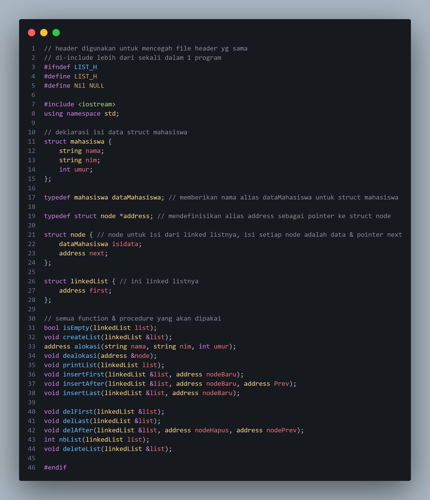
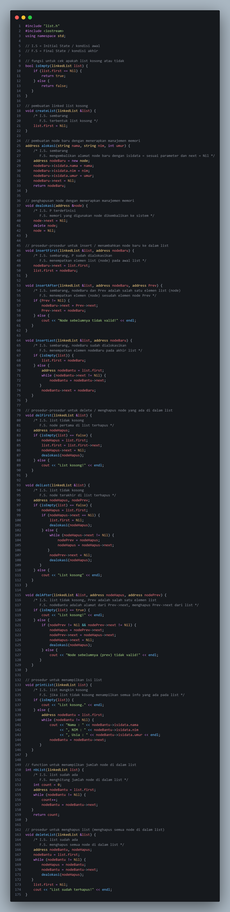
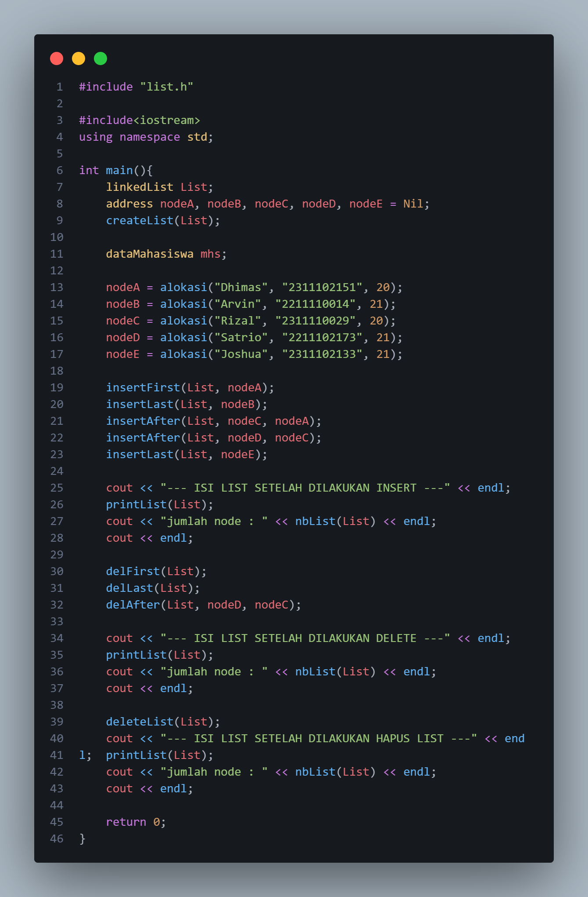
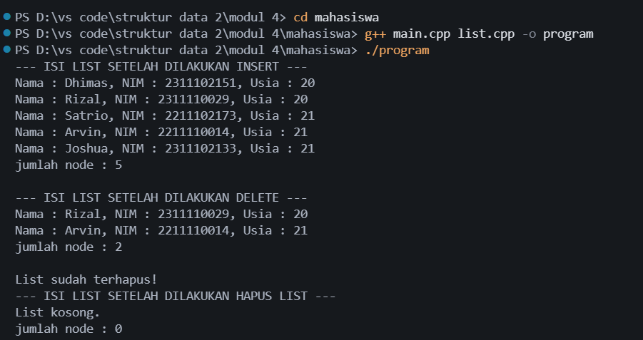
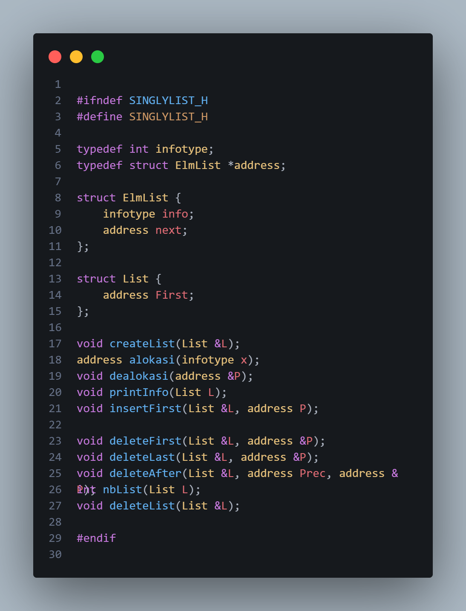
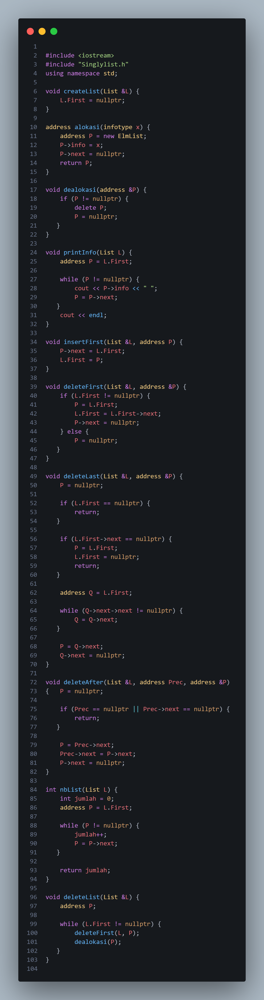
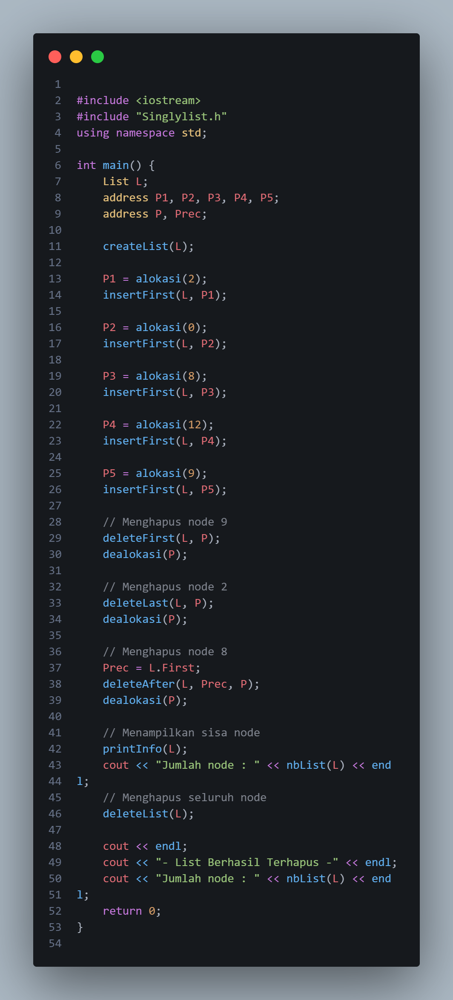
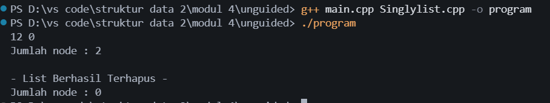

# <h1 align="center">Laporan Praktikum Modul 4 - Struktur Data</h1>
<p align="center">Trisna Kusuma Ramadhany - 103312400277</p>

## Dasar Teori

Linked list merupakan struktur data linear yang terdiri atas kumpulan node yang saling terhubung menggunakan pointer. Setiap node pada singly linked list memiliki bagian data (`info`) dan pointer `next` yang menunjuk ke node berikutnya. Berbeda dengan array, elemen linked list tidak harus disimpan secara berurutan di memori karena hubungan antar-elemen ditentukan melalui pointer.

Abstract Data Type (ADT) digunakan untuk memisahkan definisi struktur data dengan operasi yang dapat dilakukan terhadapnya. Pada praktikum ini, ADT Singly Linked List diimplementasikan menggunakan file header (`.h`), file implementasi (`.cpp`), dan program utama (`main.cpp`). Operasi yang digunakan meliputi pembuatan list kosong, alokasi dan dealokasi memori, penambahan node di awal, penghapusan node di awal, akhir, dan setelah node tertentu, penghitungan jumlah node, serta penghapusan seluruh isi list.

Pointer dan alokasi memori dinamis menjadi bagian penting dalam linked list karena setiap node dibuat saat dibutuhkan menggunakan `new` dan dihapus menggunakan `delete`. Dengan memahami operasi tersebut, mahasiswa dapat mengelola data yang jumlahnya dapat berubah selama program berjalan serta menjaga agar node yang sudah dihapus tidak lagi menjadi bagian dari list.

## Guided

### 1. `list.h`



File `list.h` berfungsi sebagai file header yang berisi deklarasi struktur data dan fungsi atau prosedur untuk mengelola linked list. Struktur `mahasiswa` menyimpan data nama, NIM, dan umur. Tipe `dataMahasiswa` digunakan sebagai alias untuk struktur tersebut, sedangkan `address` merupakan pointer yang menunjuk ke node. Struktur `node` menyimpan data mahasiswa dan pointer `next`, sementara `linkedList` memiliki pointer `first` yang menunjuk ke node pertama.

File ini juga mendeklarasikan operasi seperti `createList()`, `alokasi()`, `dealokasi()`, `printList()`, `insertFirst()`, `insertAfter()`, `insertLast()`, `delFirst()`, `delLast()`, `delAfter()`, `nbList()`, dan `deleteList()`. Include guard digunakan untuk mencegah file header diproses berulang kali.

### 2. `list.cpp`



File `list.cpp` berisi implementasi fungsi dan prosedur yang telah dideklarasikan pada `list.h`. Fungsi `isEmpty()` memeriksa apakah list kosong, sedangkan `createList()` menginisialisasi pointer pertama dengan `Nil`. Fungsi `alokasi()` membuat node baru dan mengisi data nama, NIM, serta umur. Prosedur `dealokasi()` menghapus node dan mengembalikan memori yang digunakan kepada sistem.

Operasi penambahan dilakukan melalui `insertFirst()`, `insertAfter()`, dan `insertLast()`. Sementara itu, `delFirst()`, `delLast()`, dan `delAfter()` digunakan untuk menghapus node pada posisi tertentu. Prosedur `printList()` menampilkan data seluruh mahasiswa, `nbList()` menghitung jumlah node, dan `deleteList()` menghapus seluruh node yang masih tersimpan di dalam list.

### 3. `main.cpp`



File `main.cpp` merupakan program utama yang menggunakan ADT linked list mahasiswa. Program membuat list kosong, kemudian mengalokasikan lima node berisi data mahasiswa. Node dimasukkan menggunakan operasi `insertFirst()`, `insertLast()`, dan `insertAfter()`. Setelah isi list dan jumlah node ditampilkan, program menjalankan operasi penghapusan melalui `delFirst()`, `delLast()`, dan `delAfter()`. Pada bagian akhir, `deleteList()` dipanggil untuk menghapus seluruh node, lalu program menampilkan kembali isi list dan jumlah node.

### Output Guided



Program Guided menunjukkan proses penambahan node, penghapusan beberapa node, dan penghapusan seluruh list. Jumlah node dapat diperiksa menggunakan `nbList()`, sedangkan isi list ditampilkan menggunakan `printList()`. Setelah `deleteList()` dijalankan, list menjadi kosong dan jumlah node bernilai nol.

## Unguided

### 1. Soal 1 — Membuat Singly Linked List

#### a. `Singlylist.h`



File `Singlylist.h` mendefinisikan ADT Singly Linked List sederhana dengan `infotype` bertipe `int`, `address` sebagai pointer ke `ElmList`, dan struktur `List` yang menyimpan pointer `First`. File ini mendeklarasikan prosedur dan fungsi untuk membuat list, mengalokasikan dan menghapus memori node, menampilkan isi list, menambahkan node di awal, menghapus node, menghitung jumlah node, serta menghapus seluruh list.

#### b. `Singlylist.cpp`



File `Singlylist.cpp` berisi implementasi operasi pada singly linked list. `createList()` membuat list kosong dengan mengatur `First` menjadi `nullptr`. `alokasi()` membuat node baru, menyimpan nilai pada bagian `info`, dan mengatur `next` menjadi `nullptr`. `insertFirst()` menempatkan node baru pada bagian awal list, sedangkan `printInfo()` menelusuri list dari node pertama hingga akhir dan menampilkan setiap nilai.

Operasi `deleteFirst()` menghapus node pertama, `deleteLast()` menghapus node terakhir, dan `deleteAfter()` menghapus node yang berada setelah node acuan. Fungsi `nbList()` menghitung jumlah node dengan menelusuri list, sedangkan `deleteList()` menghapus seluruh node satu per satu menggunakan `deleteFirst()` dan `dealokasi()`.

#### c. `main.cpp`



Program utama membuat list dan mengalokasikan node dengan nilai 2, 0, 8, 12, dan 9. Setiap node dimasukkan menggunakan `insertFirst()`. Karena node baru selalu ditambahkan di awal, urutan akhir list menjadi 9, 12, 8, 0, 2.

#### Output 



```text
12 0
Jumlah node : 2

- List Berhasil Terhapus -
Jumlah node : 0
```

Output memperlihatkan bahwa setelah node 9, 2, dan 8 dihapus, hanya node 12 dan 0 yang tersisa sehingga jumlah node adalah 2. Setelah `deleteList()` dijalankan, semua node telah dihapus dan jumlah node menjadi 0.

## Kesimpulan

Berdasarkan praktikum Struktur Data Modul 4, dapat disimpulkan bahwa singly linked list merupakan struktur data yang menghubungkan node menggunakan pointer. Melalui implementasi ADT dalam file header, file implementasi, dan program utama, praktikum ini mempelajari cara membuat list, mengalokasikan dan dealokasi memori, menambahkan node di awal maupun pada posisi tertentu, menghapus node pertama, terakhir, dan setelah node acuan, serta menghitung jumlah node. Penggunaan `deleteList()` juga menunjukkan cara menghapus seluruh node hingga list kosong.

## Referensi

[1] Triase. (2020). *Diktat Edisi Revisi: Struktur Data*. Medan: Universitas Islam Negeri Sumatera Utara Medan.

[2] Indahyati, Uce, dan Rahmawati Yunianita. (2020). *Buku Ajar Algoritma dan Pemrograman dalam Bahasa C++*. Sidoarjo: Umsida Press. https://doi.org/10.21070/2020/978-623-6833-67-4.
