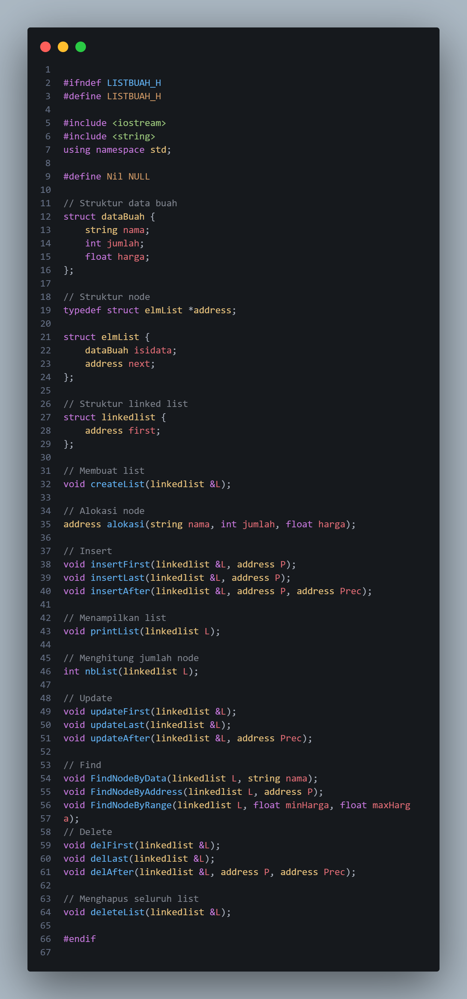
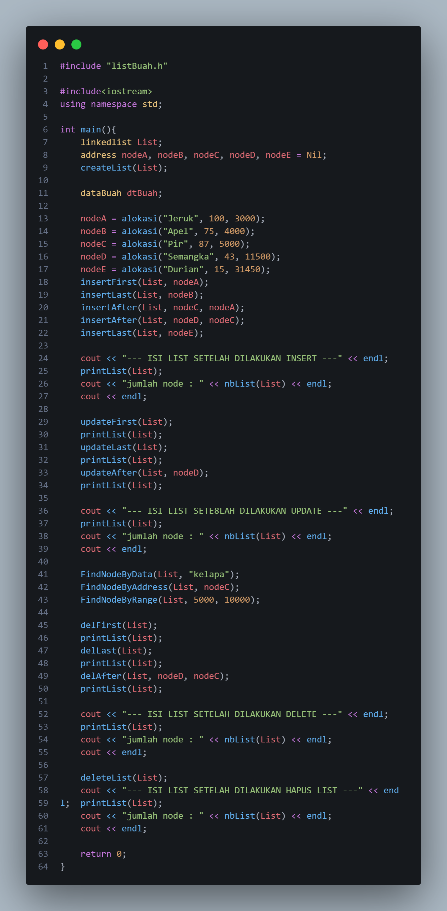
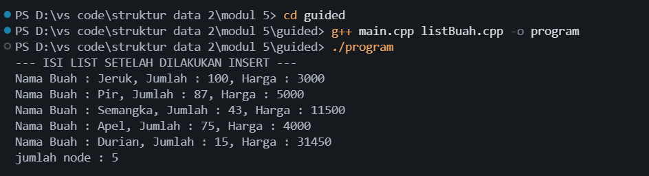
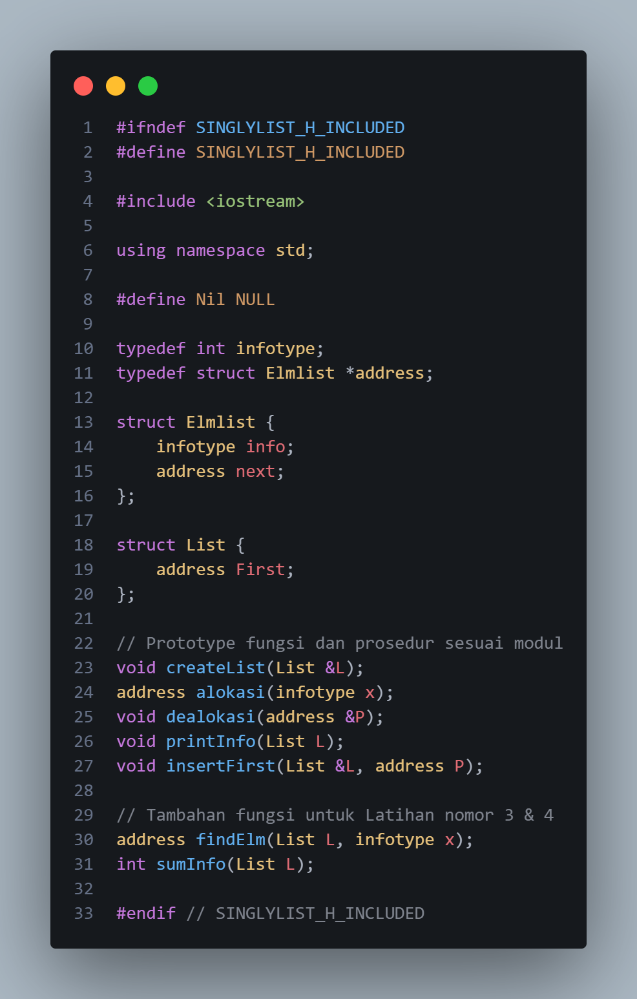
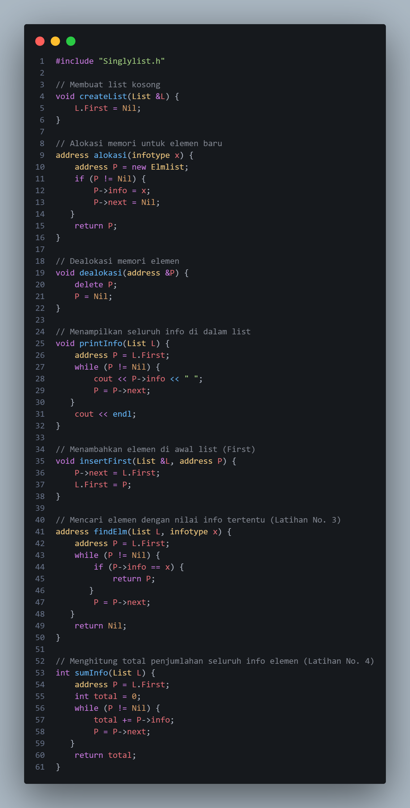
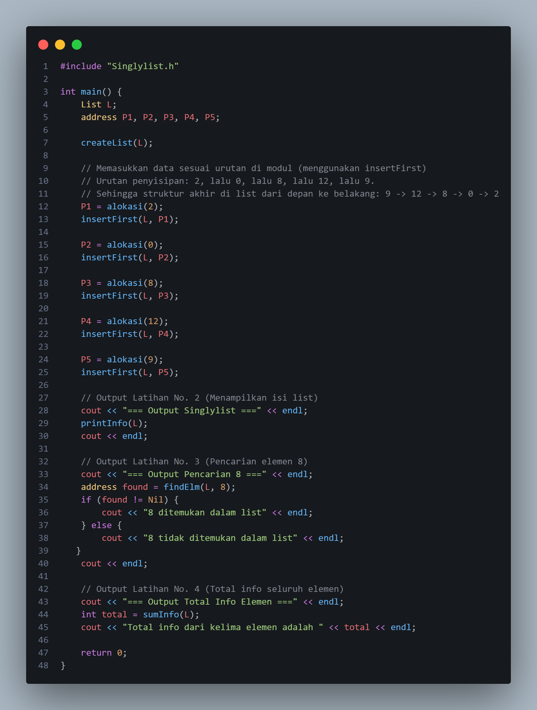
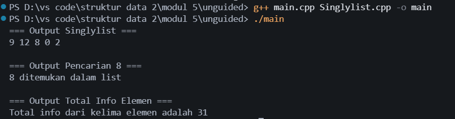

# <h1 align="center">Laporan Praktikum Modul 5 - Struktur Data</h1>

Trisna Kusuma Ramadhany - 103112400277

## Dasar Teori

Singly linked list merupakan struktur data linear yang terdiri atas sejumlah node yang saling terhubung melalui pointer `next`. Setiap node menyimpan informasi dan alamat node berikutnya, sedangkan pointer `first` atau `First` menunjuk elemen paling awal. Berbeda dengan array, node pada linked list dialokasikan secara dinamis sehingga penambahan dan penghapusan elemen dapat dilakukan tanpa harus memindahkan seluruh data.

Pada Modul 5, pembahasan singly linked list dilanjutkan dengan operasi pembaruan data (*update*) dan pencarian (*searching*). Operasi `updateFirst()`, `updateLast()`, dan `updateAfter()` digunakan untuk mengubah informasi pada node pertama, terakhir, atau node setelah node acuan. Pencarian dilakukan dengan menelusuri node satu per satu, baik berdasarkan nilai data, alamat node, maupun rentang nilai tertentu. Penelusuran ini juga dapat dimanfaatkan untuk mencari suatu elemen dan menghitung total nilai data dalam list.

Implementasi Abstract Data Type (ADT) memisahkan deklarasi struktur dan fungsi pada file header (`.h`), implementasi operasi pada file `.cpp`, serta pemanggilan operasi pada `main.cpp`. Pembagian ini memudahkan pengembangan dan pengujian program. Pengelolaan memori tetap penting karena node dibuat menggunakan `new` dan perlu dihapus menggunakan `delete` ketika tidak lagi digunakan.

## Guided

### 1. `listBuah.h`

File `listBuah.h` mendefinisikan ADT singly linked list untuk mengelola data buah. Struktur `dataBuah` menyimpan tiga atribut, yaitu `nama` bertipe `string`, `jumlah` bertipe `int`, dan `harga` bertipe `float`. Struktur `elmList` memiliki bagian `isidata` untuk menyimpan data buah dan pointer `next` yang menunjuk node berikutnya. Tipe `address` digunakan sebagai pointer ke `elmList`, sedangkan struktur `linkedlist` memiliki pointer `first` sebagai penanda node pertama.

File header ini mendeklarasikan fungsi `createList()`, `alokasi()`, `insertFirst()`, `insertLast()`, `insertAfter()`, `printList()`, dan `nbList()`. Selain itu, terdapat operasi pembaruan `updateFirst()`, `updateLast()`, `updateAfter()`, pencarian `FindNodeByData()`, `FindNodeByAddress()`, `FindNodeByRange()`, serta penghapusan `delFirst()`, `delLast()`, `delAfter()`, dan `deleteList()`. Include guard digunakan untuk menghindari pemrosesan header berulang kali.

### 2. `listBuah.cpp`

File `listBuah.cpp` berisi implementasi pengelolaan linked list data buah. Fungsi `isEmpty()` memeriksa apakah list kosong, `createList()` menginisialisasi pointer `first`, dan `alokasi()` membuat node baru sekaligus mengisi nama, jumlah, dan harga buah. Fungsi `insertFirst()`, `insertAfter()`, dan `insertLast()` mengatur hubungan pointer agar node dapat ditambahkan pada posisi yang diperlukan. `printList()` menampilkan isi node, sedangkan `nbList()` menghitung jumlah node yang masih terhubung.

Bagian utama Modul 5 adalah operasi update dan searching. Fungsi `updateFirst()`, `updateLast()`, dan `updateAfter()` meminta masukan untuk memperbarui data pada posisi tertentu. Fungsi `FindNodeByData()` mencari buah berdasarkan nama, `FindNodeByAddress()` membandingkan alamat node, dan `FindNodeByRange()` menampilkan buah dengan harga dalam batas yang ditentukan. File ini juga mengimplementasikan `delFirst()`, `delLast()`, `delAfter()`, dan `deleteList()` untuk menghapus node serta membebaskan memorinya.

### 3. `main.cpp`

File `main.cpp` merupakan program utama yang menguji operasi linked list buah. Program membuat list kosong dan mengalokasikan lima node, yaitu Jeruk (100, 3000), Apel (75, 4000), Pir (87, 5000), Semangka (43, 11500), dan Durian (15, 31450). Node ditambahkan menggunakan kombinasi `insertFirst()`, `insertLast()`, dan `insertAfter()`, kemudian seluruh isi list dan jumlah node ditampilkan.

Selanjutnya, program menjalankan `updateFirst()`, `updateLast()`, dan `updateAfter()` untuk mengubah data melalui input pengguna. Proses pencarian dilakukan menggunakan nama `kelapa`, alamat `nodeC`, dan rentang harga 5000 sampai 10000. Setelah itu, program menjalankan `delFirst()`, `delLast()`, dan `delAfter()`, lalu menghapus seluruh list menggunakan `deleteList()`. Setiap tahap utama disertai tampilan isi list dan jumlah node.

### Output Guided

Pada tahap insert, kelima node tersusun dalam urutan Jeruk, Pir, Semangka, Apel, dan Durian sehingga jumlah node adalah 5. Tahap update meminta input baru untuk node pertama, terakhir, dan node setelah acuan. Hasil data setelah update bergantung pada nilai yang dimasukkan saat program dijalankan. Tahap searching menunjukkan pencarian berdasarkan nama, alamat, dan rentang harga; pencarian nama `kelapa` akan menyatakan data tidak ditemukan apabila nama tersebut tidak dimasukkan saat update. Setelah proses delete dan `deleteList()`, isi list berkurang hingga akhirnya kosong dengan jumlah node 0.

## Unguided

### 1. Soal 1 — Implementasi Singly Linked List dan Operasi Pencarian

#### a. `Singlylist.h`

File `Singlylist.h` mendefinisikan ADT singly linked list dengan `infotype` bertipe `int`, `address` sebagai pointer ke struktur `Elmlist`, dan struktur `List` yang menyimpan pointer `First`. Setiap node memiliki `info` sebagai nilai data dan `next` sebagai penghubung ke node berikutnya. Header ini mendeklarasikan `createList()`, `alokasi()`, `dealokasi()`, `printInfo()`, dan `insertFirst()`. Untuk latihan Modul 5, ditambahkan fungsi `findElm()` untuk mencari elemen berdasarkan nilai dan `sumInfo()` untuk menjumlahkan semua informasi pada list.

#### b. `Singlylist.cpp`

File `Singlylist.cpp` mengimplementasikan fungsi yang dideklarasikan pada header. `createList()` membuat list kosong dengan mengatur `First` menjadi `Nil`, sedangkan `alokasi()` membuat node baru dan menyimpan nilai integer pada `info`. `insertFirst()` menambahkan node di awal list, `printInfo()` menampilkan isi list, dan `dealokasi()` membebaskan memori node.

Fungsi `findElm()` menelusuri list mulai dari node pertama hingga menemukan nilai yang dicari, kemudian mengembalikan alamat node tersebut. Jika tidak ditemukan, fungsi mengembalikan `Nil`. Sementara itu, `sumInfo()` menggunakan variabel `total` untuk mengakumulasi seluruh nilai `info` pada node sampai akhir list. Kedua fungsi tersebut memperlihatkan penggunaan traversal dalam operasi searching dan pengolahan data.

#### c. `main.cpp`

Program utama membuat list kosong, kemudian memasukkan lima nilai integer, yaitu 2, 0, 8, 12, dan 9 menggunakan `insertFirst()`. Karena setiap node baru ditempatkan pada bagian awal, urutan akhir list menjadi 9, 12, 8, 0, 2. Program lalu menjalankan `findElm(L, 8)` untuk memeriksa keberadaan nilai 8 dan `sumInfo(L)` untuk menghitung jumlah seluruh nilai node.

#### Output

 berdasarkan kode memperlihatkan lima elemen dengan urutan 9, 12, 8, 0, 2. Pencarian nilai 8 berhasil karena nilai tersebut terdapat pada node ketiga. Fungsi `sumInfo()` menghasilkan total 31 dari penjumlahan 9 + 12 + 8 + 0 + 2. Dengan demikian, program unguided menunjukkan penerapan traversal untuk pencarian dan perhitungan data pada singly linked list.

## Kesimpulan

bahwa singly linked list tidak hanya mendukung operasi penambahan dan penghapusan node, tetapi juga pembaruan serta pencarian data. Pada bagian guided, linked list digunakan untuk menyimpan data buah yang memiliki atribut nama, jumlah, dan harga. Operasi update memungkinkan perubahan informasi pada node tertentu, sedangkan pencarian dapat dilakukan berdasarkan nama buah, alamat node, dan rentang harga. Pada bagian unguided, traversal linked list diterapkan untuk mencari elemen bernilai 8 dan menghitung total nilai seluruh node sebesar 31. Pemisahan kode ke dalam file header, implementasi, dan program utama membantu pengelolaan ADT agar lebih terstruktur.

## Referensi

[1] Triase. (2020). *Diktat Edisi Revisi: Struktur Data*. Medan: Universitas Islam Negeri Sumatera Utara Medan.

[2] Indahyati, Uce, dan Rahmawati Yunianita. (2020). *Buku Ajar Algoritma dan Pemrograman dalam Bahasa C++*. Sidoarjo: Umsida Press. https://doi.org/10.21070/2020/978-623-6833-67-4.
