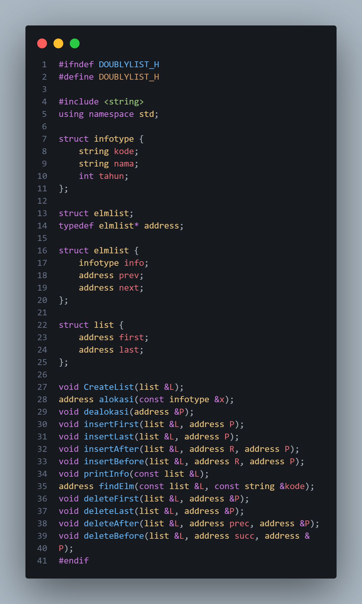
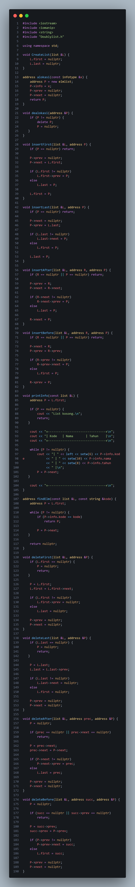
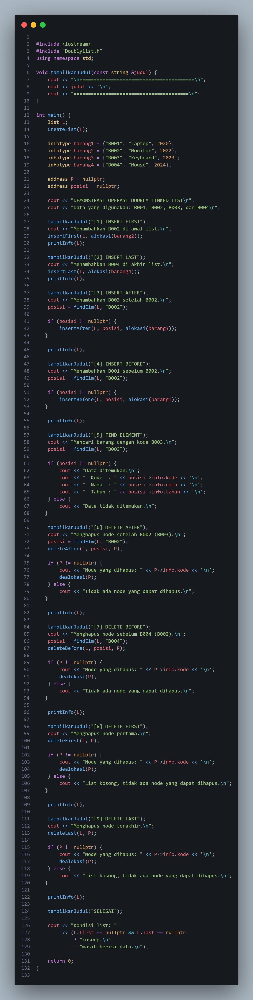
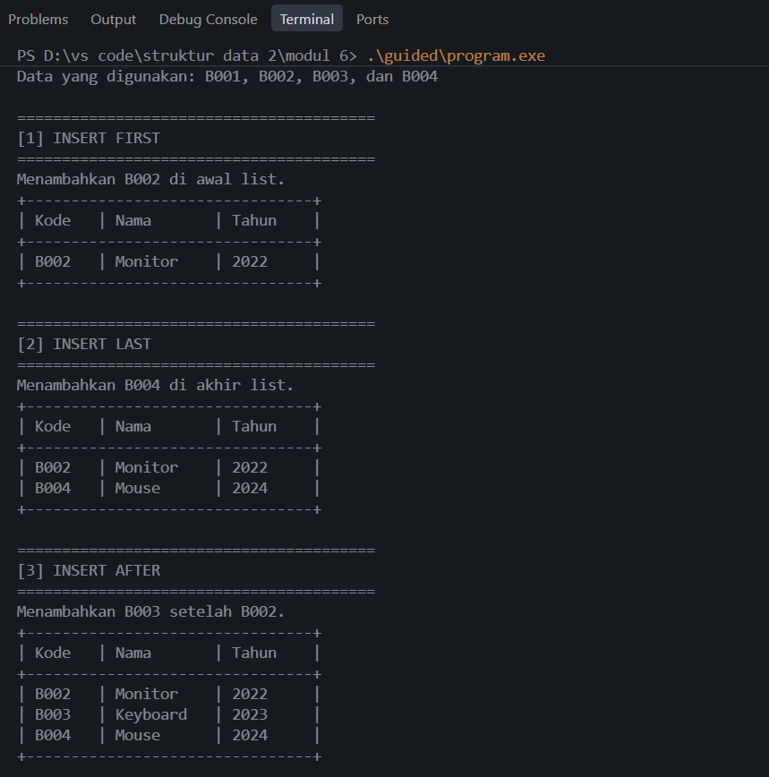
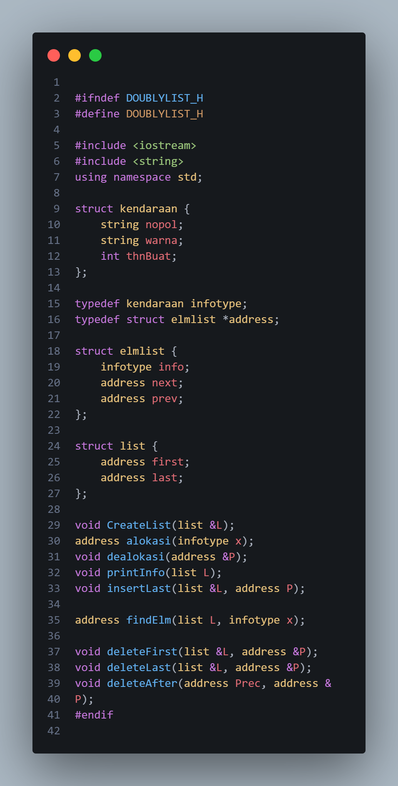
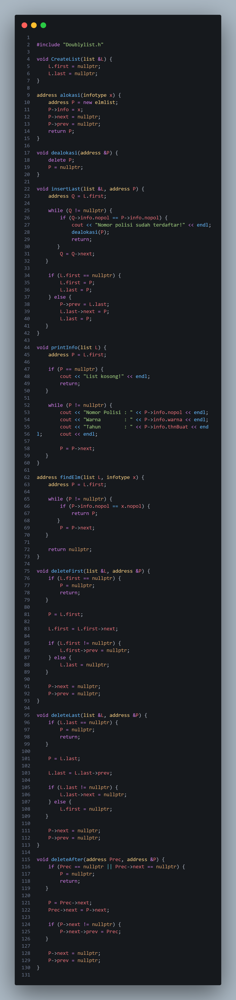
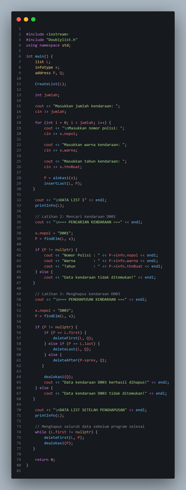
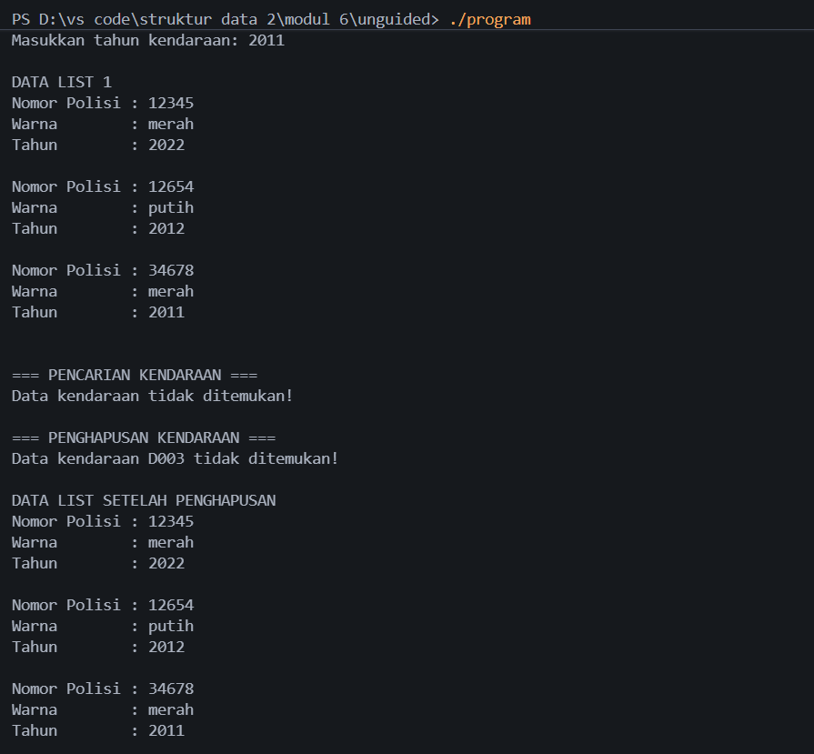

# Laporan Praktikum Modul 6 - Struktur Data

Trisna Kusuma Ramadhany - 103112400277

## Dasar Teori

Doubly Linked List merupakan struktur data linear yang setiap elemennya memiliki dua pointer, yaitu `prev` dan `next`. Pointer `prev` digunakan untuk menunjuk node sebelumnya, sedangkan `next` menunjuk node berikutnya. Struktur ini juga memiliki pointer `first` yang menunjuk elemen pertama dan `last` yang menunjuk elemen terakhir. Berbeda dengan Singly Linked List, Doubly Linked List memungkinkan proses penelusuran data dilakukan dari dua arah, yaitu maju dan mundur.

Pada Modul 6, pembahasan Doubly Linked List mencakup operasi penambahan (*insert*) dan penghapusan (*delete*) data. Operasi insert terdiri dari `insertFirst()`, `insertLast()`, `insertAfter()`, dan `insertBefore()`. Sementara itu, operasi delete terdiri dari `deleteFirst()`, `deleteLast()`, `deleteAfter()`, dan `deleteBefore()`. Selain itu, terdapat operasi pencarian (*searching*) untuk menemukan elemen berdasarkan informasi tertentu.

Implementasi Doubly Linked List menggunakan Abstract Data Type (ADT) yang dipisahkan ke dalam file header (`.h`), file implementasi (`.cpp`), dan program utama (`main.cpp`). Setiap node dialokasikan secara dinamis menggunakan `new` dan dibebaskan menggunakan `delete`. Pengaturan pointer `prev` dan `next` harus dilakukan dengan benar agar hubungan antar-node tetap terjaga.

## Guided

### 1. `Doublylist.h`

File `Doublylist.h` merupakan file header yang berisi deklarasi struktur data Doubly Linked List. Struktur `infotype` digunakan untuk menyimpan informasi barang yang terdiri dari kode, nama, dan tahun. Struktur `elmlist` memiliki bagian `info` untuk menyimpan data serta pointer `prev` dan `next` sebagai penghubung antar-node. Struktur `list` memiliki pointer `first` dan `last` untuk menunjukkan elemen pertama dan terakhir.

File ini juga mendeklarasikan berbagai fungsi yang digunakan dalam pengelolaan list, seperti `CreateList()`, `alokasi()`, `dealokasi()`, `insertFirst()`, `insertLast()`, `insertAfter()`, `insertBefore()`, `printInfo()`, `findElm()`, `deleteFirst()`, `deleteLast()`, `deleteAfter()`, dan `deleteBefore()`.

### 2. `Doublylist.cpp`

File `Doublylist.cpp` berisi implementasi dari fungsi-fungsi yang telah dideklarasikan pada file header. Fungsi `CreateList()` digunakan untuk membuat list kosong dengan mengatur pointer `first` dan `last` menjadi `nullptr`. Fungsi `alokasi()` digunakan untuk membuat node baru dan mengisi informasi barang, sedangkan `dealokasi()` digunakan untuk membebaskan memori node.

Operasi penambahan data dilakukan melalui fungsi `insertFirst()`, `insertLast()`, `insertAfter()`, dan `insertBefore()` dengan mengatur hubungan pointer antar-node. Fungsi `printInfo()` digunakan untuk menampilkan seluruh data barang, sedangkan `findElm()` digunakan untuk mencari node berdasarkan kode barang.

Selain itu, terdapat fungsi `deleteFirst()`, `deleteLast()`, `deleteAfter()`, dan `deleteBefore()` yang digunakan untuk menghapus node berdasarkan posisinya. Setiap proses penghapusan mengatur kembali hubungan pointer agar struktur Doubly Linked List tetap terhubung dengan benar.

### 3. `main.cpp`

File `main.cpp` merupakan program utama yang digunakan untuk menguji seluruh operasi Doubly Linked List. Program diawali dengan membuat list kosong menggunakan `CreateList()`, kemudian menyiapkan empat data barang, yaitu B001 (Laptop), B002 (Monitor), B003 (Keyboard), dan B004 (Mouse).

Program selanjutnya menjalankan operasi `insertFirst()` untuk menambahkan B002 di awal list, `insertLast()` untuk menambahkan B004 di akhir list, `insertAfter()` untuk menambahkan B003 setelah B002, dan `insertBefore()` untuk menambahkan B001 sebelum B002. Setelah itu, program melakukan pencarian menggunakan `findElm()` untuk menemukan barang dengan kode B003.

Tahap berikutnya adalah pengujian operasi penghapusan menggunakan `deleteAfter()`, `deleteBefore()`, `deleteFirst()`, dan `deleteLast()`. Setiap node yang berhasil dihapus akan dibebaskan memorinya menggunakan `dealokasi()`. Pada akhir program, isi list diperiksa untuk memastikan bahwa seluruh data telah berhasil dihapus.

### Output Guided

Berdasarkan hasil pengujian, program berhasil menjalankan sembilan operasi Doubly Linked List. Pada tahap insert, data barang berhasil disusun dengan urutan B001, B002, B003, dan B004. Selanjutnya, pencarian kode B003 berhasil menampilkan informasi barang berupa Keyboard dengan tahun 2023.

Pada tahap delete, program berhasil menghapus B003 menggunakan `deleteAfter()`, B002 menggunakan `deleteBefore()`, B001 menggunakan `deleteFirst()`, dan B004 menggunakan `deleteLast()`. Setelah seluruh operasi selesai, list berada dalam kondisi kosong. Hal ini menunjukkan bahwa operasi penambahan, pencarian, dan penghapusan dapat berjalan dengan baik.

## Unguided

### 1. Soal 1 — Implementasi ADT Doubly Linked List Data Kendaraan

#### a. `Doublylist.h`

File `Doublylist.h` mendefinisikan ADT Doubly Linked List untuk menyimpan data kendaraan. Struktur `kendaraan` memiliki tiga atribut, yaitu `nopol` bertipe string, `warna` bertipe string, dan `thnBuat` bertipe integer. Tipe `infotype` digunakan untuk merepresentasikan data kendaraan, sedangkan `address` merupakan pointer menuju elemen list.

Struktur `elmlist` memiliki bagian `info`, `next`, dan `prev` untuk menyimpan informasi serta menghubungkan node sebelumnya dan berikutnya. Struktur `list` memiliki pointer `first` dan `last`. File ini juga mendeklarasikan fungsi `CreateList()`, `alokasi()`, `dealokasi()`, `printInfo()`, dan `insertLast()`.

#### b. `Doublylist.cpp`

File `Doublylist.cpp` berisi implementasi fungsi-fungsi untuk mengelola data kendaraan. Fungsi `CreateList()` digunakan untuk menginisialisasi list kosong, sedangkan `alokasi()` digunakan untuk membuat node baru dan menyimpan informasi kendaraan. Fungsi `dealokasi()` digunakan untuk membebaskan memori node yang sudah tidak digunakan.

Fungsi `insertLast()` digunakan untuk menambahkan kendaraan pada bagian akhir list. Sebelum memasukkan data, program memeriksa apakah nomor polisi sudah terdaftar agar tidak terjadi duplikasi. Fungsi `printInfo()` digunakan untuk menampilkan seluruh data kendaraan, sedangkan `findElm()` digunakan untuk mencari kendaraan berdasarkan nomor polisi. Selain itu, terdapat fungsi `deleteFirst()`, `deleteLast()`, dan `deleteAfter()` untuk menghapus data kendaraan sesuai dengan posisi node.

#### c. `main.cpp`

File `main.cpp` merupakan program utama yang menguji implementasi ADT Doubly Linked List untuk data kendaraan. Program meminta pengguna memasukkan jumlah kendaraan, kemudian memasukkan nomor polisi, warna, dan tahun kendaraan. Setiap data yang dimasukkan akan dibuat menjadi node baru menggunakan `alokasi()` dan ditambahkan ke bagian akhir list menggunakan `insertLast()`.

Setelah seluruh data dimasukkan, program menampilkan isi list menggunakan `printInfo()`. Selanjutnya, program melakukan pencarian kendaraan dengan nomor polisi D001 menggunakan fungsi `findElm()`. Jika data ditemukan, program menampilkan nomor polisi, warna, dan tahun kendaraan tersebut.

Pada tahap berikutnya, program mencari kendaraan dengan nomor polisi D003 dan menghapusnya menggunakan prosedur `deleteFirst()`, `deleteLast()`, atau `deleteAfter()` sesuai posisi node. Node yang berhasil dihapus kemudian dibebaskan menggunakan `dealokasi()`. Terakhir, program menampilkan kembali isi list setelah penghapusan dan membersihkan seluruh node sebelum program berakhir.

### Output Unguided

Berdasarkan hasil pengujian, program berhasil menerima data kendaraan dan menampilkannya dalam bentuk Doubly Linked List. Ketika terdapat nomor polisi yang sama, program menolak data tersebut sehingga tidak terjadi duplikasi. Pada proses pencarian, kendaraan dengan nomor polisi D001 berhasil ditemukan dan menampilkan informasi kendaraan berwarna hitam dengan tahun 90.

Selanjutnya, kendaraan dengan nomor polisi D003 berhasil dihapus dari list. Setelah proses penghapusan, data yang tersisa adalah kendaraan dengan nomor polisi D001 dan D004. Hasil tersebut menunjukkan bahwa operasi insert, searching, dan delete pada Doubly Linked List dapat diterapkan untuk mengelola data kendaraan.

## Kesimpulan

Berdasarkan praktikum Modul 6, dapat disimpulkan bahwa Doubly Linked List merupakan struktur data yang setiap node-nya memiliki dua pointer, yaitu `prev` dan `next`, sehingga penelusuran data dapat dilakukan dari dua arah. Pada bagian guided, berbagai operasi penambahan, pencarian, dan penghapusan berhasil diterapkan menggunakan data barang. Sementara itu, pada bagian unguided, Doubly Linked List digunakan untuk mengelola data kendaraan berdasarkan nomor polisi, warna, dan tahun pembuatan. Melalui praktikum ini, dapat dipahami bahwa pengaturan pointer sangat penting dalam menjaga hubungan antar-node ketika data ditambahkan maupun dihapus.

## Referensi

[1] Modul Praktikum Struktur Data. (2026). *Modul 6: Doubly Linked List (Bagian Pertama)*. Telkom University, hlm. 51–58.

[2] Triase. (2020). *Diktat Edisi Revisi: Struktur Data*. Medan: Universitas Islam Negeri Sumatera Utara Medan.

[3] Indahyati, Uce, dan Rahmawati Yunianita. (2020). *Buku Ajar Algoritma dan Pemrograman dalam Bahasa C++*. Sidoarjo: Umsida Press. https://doi.org/10.21070/2020/978-623-6833-67-4.
