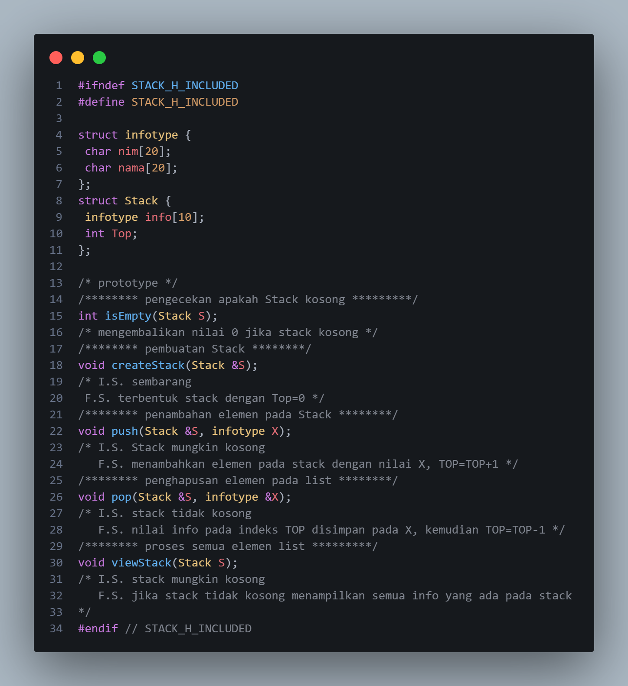
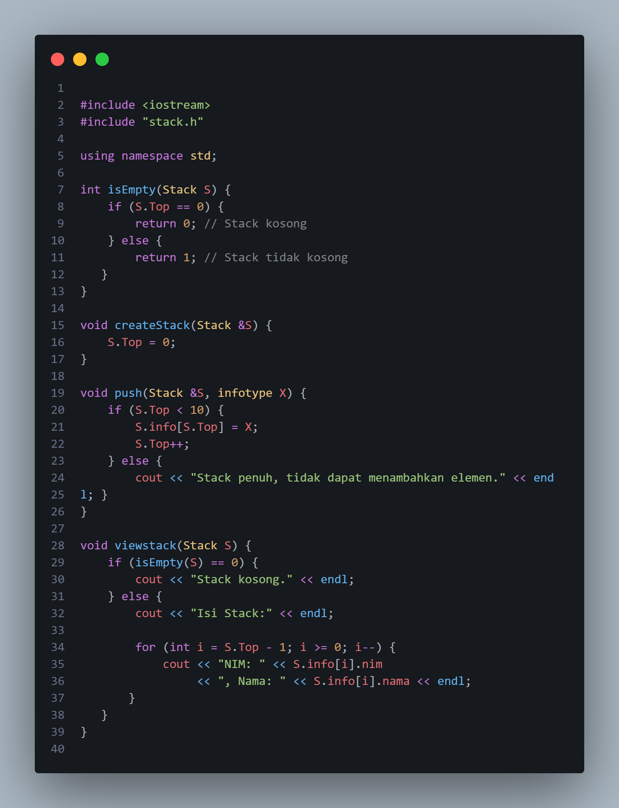
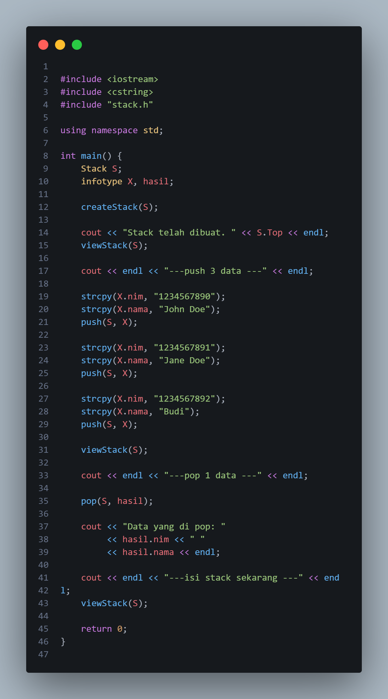
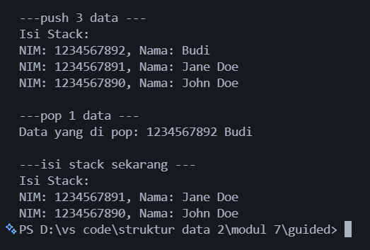
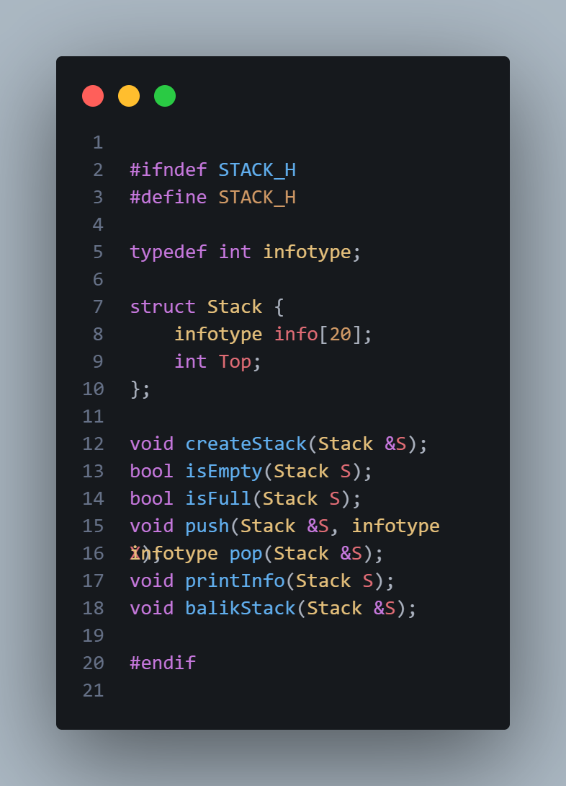
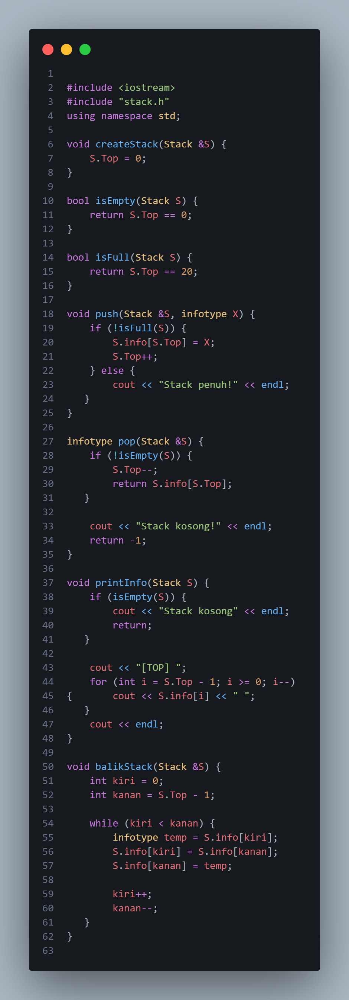
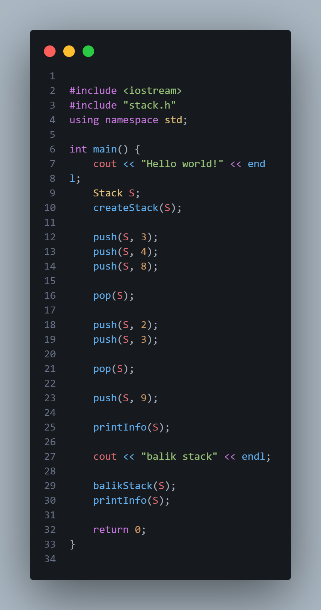
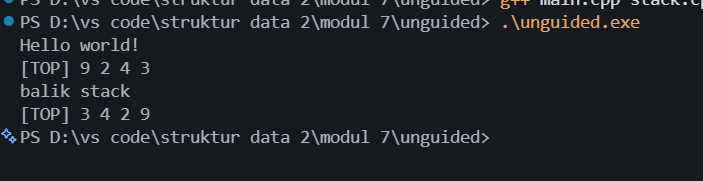

# Laporan Praktikum Modul 7 - Struktur Data

Trisna Kusuma Ramadhany - 103112400277

## Dasar Teori

Stack merupakan salah satu struktur data linear yang menggunakan prinsip LIFO (*Last In First Out*), yaitu data yang terakhir dimasukkan akan menjadi data pertama yang dikeluarkan. Konsep stack dapat diibaratkan seperti tumpukan benda, ketika sebuah benda ditambahkan maka benda tersebut diletakkan pada bagian paling atas, sedangkan pengambilan benda juga dilakukan dari bagian paling atas.

Operasi utama pada stack adalah `push()` dan `pop()`. Operasi `push()` digunakan untuk menambahkan elemen ke dalam stack, sedangkan `pop()` digunakan untuk mengambil atau menghapus elemen teratas. Posisi elemen teratas ditunjukkan oleh variabel `Top`. Pada stack dengan representasi array, indeks `Top` akan bertambah ketika data dimasukkan dan berkurang ketika data dikeluarkan.

Pada Modul 7, stack diimplementasikan menggunakan array. Struktur data stack dibuat dalam bentuk ADT (*Abstract Data Type*) yang dipisahkan menjadi file header (`stack.h`), file implementasi (`stack.cpp`), dan program utama (`main.cpp`). Selain operasi dasar, latihan juga menerapkan proses membalik isi stack, memasukkan data secara ascending, serta membaca input pengguna sampai tombol Enter ditekan.

## Guided

### 1. `stack.h`

File `stack.h` merupakan file header yang berisi deklarasi struktur data stack. Struktur `infotype` digunakan untuk menyimpan data mahasiswa berupa NIM dan nama. Struktur `Stack` memiliki array `info` untuk menampung data mahasiswa serta variabel `Top` untuk menunjukkan posisi elemen teratas. File ini juga berisi deklarasi fungsi `isEmpty()`, `createStack()`, `push()`, `pop()`, dan `viewStack()`.

### 2. `stack.cpp`

File `stack.cpp` berisi implementasi fungsi-fungsi yang telah dideklarasikan pada `stack.h`. Fungsi `createStack()` digunakan untuk menginisialisasi stack kosong dengan nilai `Top` sama dengan 0. Fungsi `isEmpty()` digunakan untuk memeriksa apakah stack kosong. Fungsi `push()` menambahkan data mahasiswa ke dalam array selama kapasitas stack masih tersedia.

Fungsi `pop()` digunakan untuk mengambil data yang berada pada posisi teratas, menyimpannya ke variabel keluaran, kemudian mengurangi nilai `Top`. Sementara itu, fungsi `viewStack()` digunakan untuk menampilkan seluruh isi stack mulai dari elemen teratas hingga elemen terbawah. Pada implementasi, penulisan nama fungsi harus konsisten antara deklarasi, definisi, dan pemanggilannya, termasuk penggunaan huruf besar dan kecil.

### 3. `main.cpp`

File `main.cpp` merupakan program utama untuk menguji operasi stack pada data mahasiswa. Program diawali dengan membuat stack kosong menggunakan `createStack()`, kemudian menampilkan kondisi awal stack. Selanjutnya, program menyiapkan data mahasiswa yang berisi NIM dan nama, lalu memasukkannya ke dalam stack menggunakan `push()`.

Setelah tiga data dimasukkan, program menampilkan isi stack menggunakan `viewStack()`. Program kemudian menjalankan operasi `pop()` untuk mengambil satu data teratas dan menampilkan data yang berhasil dikeluarkan. Terakhir, isi stack ditampilkan kembali untuk melihat perubahan setelah operasi pengambilan data.

### Output Guided

Berdasarkan hasil pengujian, stack berhasil dibuat dalam keadaan kosong dengan nilai `Top` sama dengan 0. Tiga data mahasiswa berhasil dimasukkan ke dalam stack dan ditampilkan berdasarkan urutan LIFO, sehingga data yang terakhir dimasukkan berada pada posisi paling atas. Setelah operasi `pop()` dilakukan, satu data teratas berhasil diambil dan jumlah elemen dalam stack berkurang. Hasil tersebut menunjukkan bahwa operasi pembuatan stack, penambahan data, penampilan data, dan pengambilan data dapat berjalan sesuai prinsip stack.

## Unguided

### 1. Soal 1 — Implementasi ADT Stack Menggunakan Array

#### a. `stack.h`

File `stack.h` mendefinisikan ADT Stack menggunakan array dengan tipe data `infotype` berupa integer. Struktur `Stack` memiliki array `info` dengan kapasitas 20 elemen dan variabel `Top` sebagai penanda posisi teratas. File ini juga mendeklarasikan fungsi `createStack()`, `isEmpty()`, `isFull()`, `push()`, `pop()`, `printInfo()`, dan `balikStack()`.

#### b. `stack.cpp`

File `stack.cpp` berisi implementasi fungsi-fungsi stack. Fungsi `createStack()` mengatur `Top` menjadi 0. Fungsi `isEmpty()` memeriksa apakah stack kosong, sedangkan `isFull()` memeriksa apakah kapasitas array telah terpenuhi. Fungsi `push()` menambahkan data integer ke posisi berikutnya selama stack belum penuh.

Fungsi `pop()` mengambil elemen paling atas dan mengurangi nilai `Top`. Fungsi `printInfo()` menampilkan isi stack dari posisi teratas ke terbawah. Sementara itu, fungsi `balikStack()` membalik urutan elemen dengan menukar elemen dari kedua ujung array secara bertahap.

#### c. `main.cpp`

File `main.cpp` digunakan untuk menguji operasi dasar stack. Program memasukkan beberapa bilangan menggunakan `push()`, melakukan pengambilan data menggunakan `pop()`, kemudian menambahkan data lainnya. Setelah seluruh operasi selesai, program menampilkan isi stack menggunakan `printInfo()`. Program selanjutnya memanggil `balikStack()` untuk membalik urutan elemen dan menampilkan kembali hasilnya.

#### Output Unguided  1

Berdasarkan hasil pengujian, program berhasil menjalankan operasi `push()` dan `pop()` pada stack. Data yang ditampilkan sebelum pembalikan adalah `9 2 4 3` dari posisi TOP ke bawah. Setelah fungsi `balikStack()` dijalankan, urutan data berubah menjadi `3 4 2 9`. Hasil tersebut menunjukkan bahwa operasi penambahan, pengambilan, penampilan, dan pembalikan elemen stack berjalan sesuai tujuan.

## Kesimpulan

Berdasarkan praktikum Modul 7, dapat disimpulkan bahwa Stack merupakan struktur data yang menerapkan prinsip LIFO (*Last In First Out*), yaitu data terakhir yang dimasukkan akan menjadi data pertama yang dikeluarkan. Pada bagian guided, stack digunakan untuk menyimpan data mahasiswa dan menguji operasi pembuatan stack, penambahan, penampilan, serta pengambilan data. Pada bagian unguided, stack diimplementasikan menggunakan array dengan operasi `push()`, `pop()`, `printInfo()`, dan `balikStack()`. Selain itu, fungsi `pushAscending()` digunakan untuk memasukkan data secara terurut, sedangkan `getInputStream()` digunakan untuk menerima masukan angka dari pengguna sampai tombol Enter ditekan. Melalui praktikum ini, dapat dipahami cara kerja stack serta penerapan operasi-operasinya menggunakan array.

## Referensi

[1] Modul Praktikum Struktur Data. (2026). *Modul 7: Stack*. Telkom University, hlm. 59–65.

[2] Triase. (2020). *Diktat Edisi Revisi: Struktur Data*. Medan: Universitas Islam Negeri Sumatera Utara Medan.

[3] Indahyati, Uce, dan Rahmawati Yunianita. (2020). *Buku Ajar Algoritma dan Pemrograman dalam Bahasa C++*. Sidoarjo: Umsida Press. https://doi.org/10.21070/2020/978-623-6833-67-4.
