# <h1 align="center">Laporan Praktikum Modul 3 - Struktur Data</h1>

Trisna Kusuma Ramadhany - 103312400277

## Dasar Teori
 Struktur data merupakan cara untuk menyimpan dan mengelola data agar dapat diproses secara terstruktur. Dalam bahasa C++, array digunakan untuk menyimpan sekumpulan data dengan tipe yang sama, sedangkan struct digunakan untuk mengelompokkan beberapa variabel dengan tipe data berbeda ke dalam satu kesatuan.

Abstract Data Type (ADT) merupakan konsep yang menggabungkan struktur data dengan operasi untuk mengolahnya. Implementasi ADT dapat dipisahkan menjadi file header (.h), file implementasi (.cpp), dan file utama (main.cpp) agar program lebih terorganisasi. Fungsi dan prosedur digunakan untuk menjalankan proses tertentu, seperti memasukkan data, menghitung nilai akhir, dan menampilkan informasi.

Pointer merupakan variabel yang menyimpan alamat memori variabel lain. Pointer dapat digunakan untuk mengakses dan mengubah nilai melalui alamat yang ditunjuk. Selain itu, operasi pertukaran (swapping) digunakan untuk menukar nilai dua elemen array atau dua variabel dengan bantuan variabel sementara. Konsep array, ADT, fungsi, prosedur, dan pointer diterapkan dalam praktikum ini untuk memahami pengelolaan serta manipulasi data menggunakan C++.
## Guided 

### 1. mahasiswa.cpp

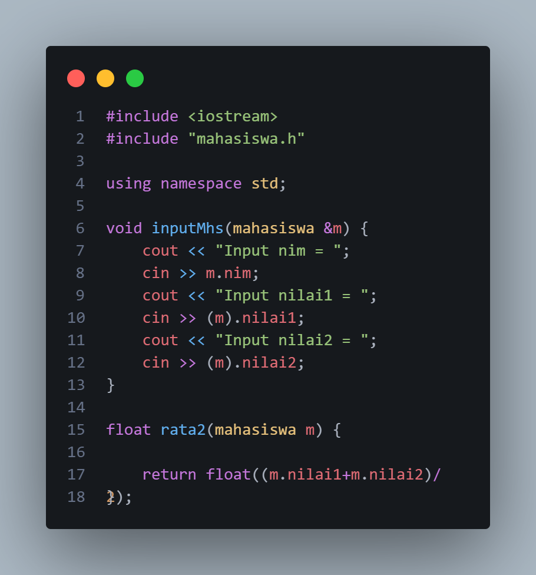

Kode tersebut merupakan implementasi fungsi untuk memasukkan data mahasiswa dan menghitung nilai rata-rata menggunakan bahasa C++. Library iostream digunakan untuk menjalankan operasi input dan output, sedangkan file mahasiswa.h dipanggil untuk menggunakan deklarasi struktur data mahasiswa yang telah dibuat sebelumnya. Perintah using namespace std; digunakan agar program dapat menggunakan fungsi seperti cin dan cout tanpa menuliskan awalan std::.
Fungsi inputMhs() digunakan untuk memasukkan data mahasiswa berupa NIM, nilai pertama, dan nilai kedua. Parameter mahasiswa &m menggunakan tanda referensi (&) sehingga perubahan data yang dimasukkan langsung disimpan pada variabel mahasiswa yang dikirimkan ke fungsi tersebut. Perintah cin digunakan untuk menerima input dari pengguna dan menyimpannya ke dalam anggota struktur, yaitu nim, nilai1, dan nilai2.
Fungsi rata2() digunakan untuk menghitung nilai rata-rata dari dua nilai mahasiswa. Fungsi ini menerima parameter bertipe mahasiswa, kemudian menjumlahkan nilai1 dan nilai2 serta membaginya dengan dua. Hasil perhitungan dikembalikan menggunakan perintah return dalam bentuk tipe data float. Namun, agar hasil rata-rata dapat menampilkan angka desimal dengan tepat, pembagian sebaiknya dilakukan menggunakan 2.0f, seperti pada kode return (m.nilai1 + m.nilai2) / 2.0f;.

### 2. mahasiswa.h

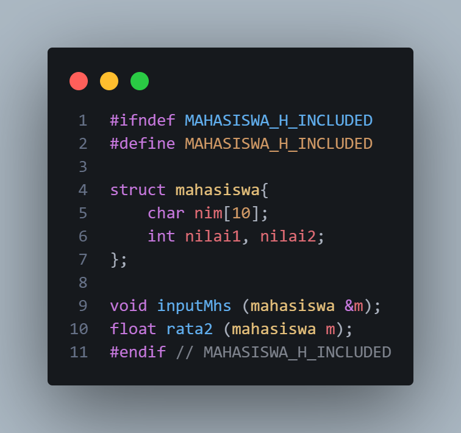

Kode tersebut merupakan file header mahasiswa.h yang berfungsi untuk mendefinisikan struktur data mahasiswa serta mendeklarasikan fungsi yang akan digunakan dalam program C++. Bagian #ifndef MAHASISWA_H_INCLUDED, #define MAHASISWA_H_INCLUDED, dan #endif disebut include guard, yang berfungsi mencegah file header diproses berulang kali ketika dimasukkan ke dalam file program yang sama.
Struktur struct mahasiswa digunakan untuk mengelompokkan data mahasiswa dalam satu kesatuan. Struktur ini memiliki tiga anggota, yaitu nim bertipe char[10] untuk menyimpan Nomor Induk Mahasiswa, serta nilai1 dan nilai2 bertipe int untuk menyimpan dua nilai mahasiswa. Selanjutnya, deklarasi void inputMhs(mahasiswa &m); digunakan untuk menyatakan fungsi yang bertugas menerima input data mahasiswa. Tanda referensi (&) pada parameter m memungkinkan perubahan data dilakukan langsung pada variabel mahasiswa yang dikirimkan. Sementara itu, deklarasi float rata2(mahasiswa m); menyatakan fungsi yang menerima data mahasiswa dan mengembalikan hasil perhitungan rata-rata kedua nilai dalam tipe data float. Dengan demikian, file header ini menjadi penghubung antara deklarasi struktur data dan fungsi dengan implementasinya pada file C++ lainnya.

### 3. main.cpp

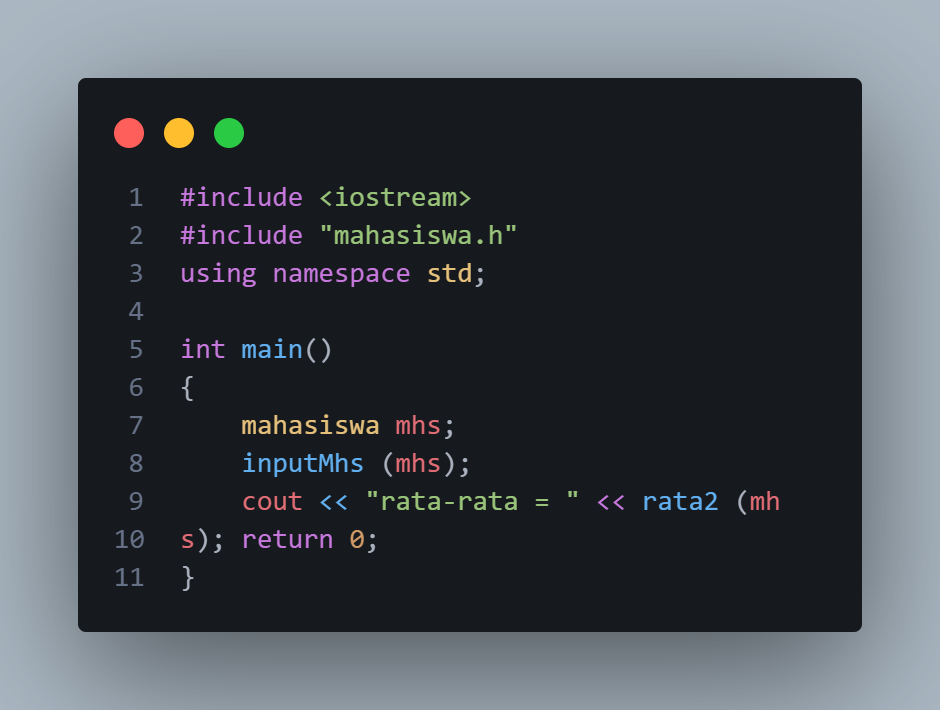

Kode tersebut merupakan program utama (main program) yang digunakan untuk menjalankan proses input data mahasiswa dan menampilkan hasil perhitungan nilai rata-rata menggunakan bahasa C++. Library iostream digunakan untuk mendukung operasi input dan output, sedangkan file mahasiswa.h disertakan agar program dapat menggunakan struktur data dan fungsi yang telah dideklarasikan sebelumnya. Perintah using namespace std; memungkinkan penggunaan cout tanpa harus menuliskan awalan std::.
Pada fungsi main(), variabel mhs dideklarasikan dengan tipe data mahasiswa untuk menyimpan data NIM, nilai pertama, dan nilai kedua. Selanjutnya, fungsi inputMhs(mhs) dipanggil untuk menerima masukan data mahasiswa dari pengguna. Setelah data dimasukkan, fungsi rata2(mhs) dipanggil untuk menghitung rata-rata dari kedua nilai tersebut. Hasil perhitungan kemudian ditampilkan menggunakan cout dengan keterangan rata-rata =. Terakhir, perintah return 0; menunjukkan bahwa program telah selesai dijalankan dengan normal.

## Unguided 

### 1. soal 1

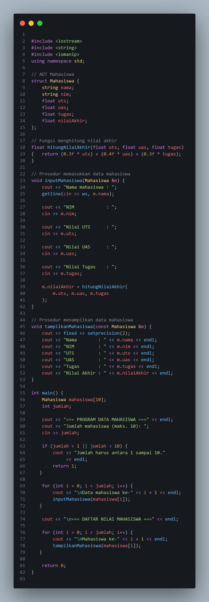

### Output 
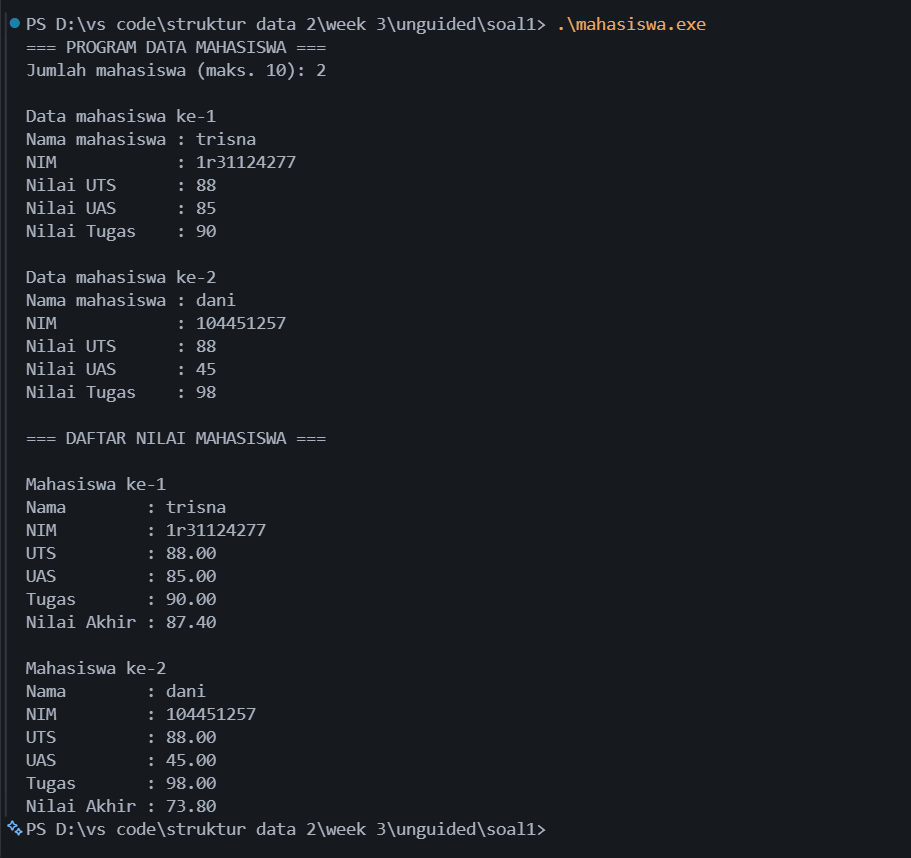

Kode tersebut merupakan program pengelolaan data mahasiswa menggunakan bahasa C++ dengan menerapkan konsep Abstract Data Type (ADT), struktur data struct, array, fungsi, dan prosedur. Library iostream digunakan untuk proses input dan output, string digunakan untuk menyimpan data teks seperti nama dan NIM, sedangkan iomanip digunakan untuk mengatur format tampilan angka. Perintah using namespace std; memungkinkan penggunaan fungsi standar C++ tanpa harus menuliskan awalan std::.
Struktur Mahasiswa digunakan untuk mengelompokkan data mahasiswa yang terdiri atas nama, NIM, nilai UTS, nilai UAS, nilai tugas, dan nilai akhir. Fungsi hitungNilaiAkhir() digunakan untuk menghitung nilai akhir mahasiswa berdasarkan bobot UTS sebesar 30%, UAS sebesar 40%, dan tugas sebesar 30%. Hasil perhitungan diperoleh dengan menjumlahkan hasil perkalian setiap nilai dengan bobotnya, kemudian dikembalikan menggunakan perintah return.
Prosedur inputMahasiswa() digunakan untuk menerima masukan data mahasiswa dari pengguna. Parameter Mahasiswa &m menggunakan referensi sehingga data yang dimasukkan langsung disimpan pada variabel mahasiswa yang dikirimkan. Perintah getline(cin >> ws, m.nama) digunakan untuk menerima nama mahasiswa, termasuk nama yang mengandung spasi. Selanjutnya, pengguna memasukkan NIM, nilai UTS, nilai UAS, dan nilai tugas. Setelah seluruh data dimasukkan, fungsi hitungNilaiAkhir() dipanggil untuk menghitung nilai akhir dan menyimpannya ke dalam anggota nilaiAkhir.
Prosedur tampilkanMahasiswa() digunakan untuk menampilkan seluruh informasi mahasiswa yang telah disimpan. Parameter const Mahasiswa &m memungkinkan data diakses tanpa menyalin seluruh objek dan tanpa mengubah isinya melalui parameter tersebut. Perintah fixed dan setprecision(2) digunakan untuk menampilkan nilai numerik dengan dua angka di belakang koma sehingga hasil terlihat lebih rapi dan konsisten.
Pada fungsi main(), array mahasiswa[10] dideklarasikan untuk menampung maksimal sepuluh data mahasiswa, sedangkan variabel jumlah digunakan untuk menentukan banyaknya mahasiswa yang akan dimasukkan. Program meminta pengguna memasukkan jumlah mahasiswa, kemudian memeriksa apakah jumlah tersebut berada dalam rentang satu sampai sepuluh. Jika jumlah tidak sesuai, program menampilkan pesan kesalahan dan menghentikan proses. Jika jumlah valid, perulangan for pertama digunakan untuk memasukkan data setiap mahasiswa melalui prosedur inputMahasiswa(). Setelah seluruh data tersimpan, perulangan for kedua digunakan untuk menampilkan data setiap mahasiswa melalui prosedur tampilkanMahasiswa(). Dengan demikian, program ini dapat mengelola beberapa data mahasiswa secara terstruktur, menghitung nilai akhir secara otomatis, dan menampilkan hasilnya sesuai dengan jumlah mahasiswa yang dimasukkan.

### 2. soal 2

### 2. main.cpp
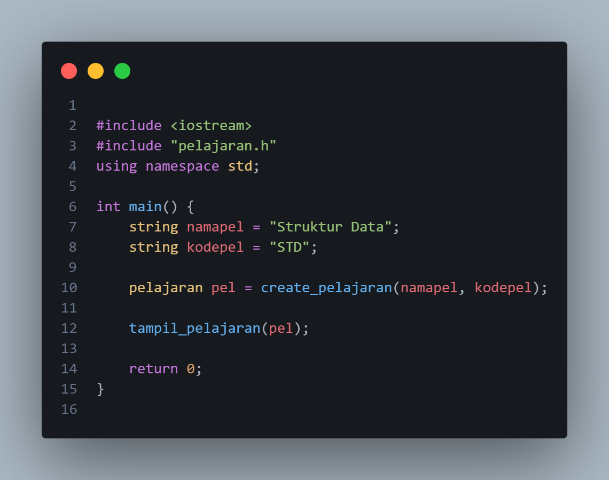

### 2. pelajaran.cpp
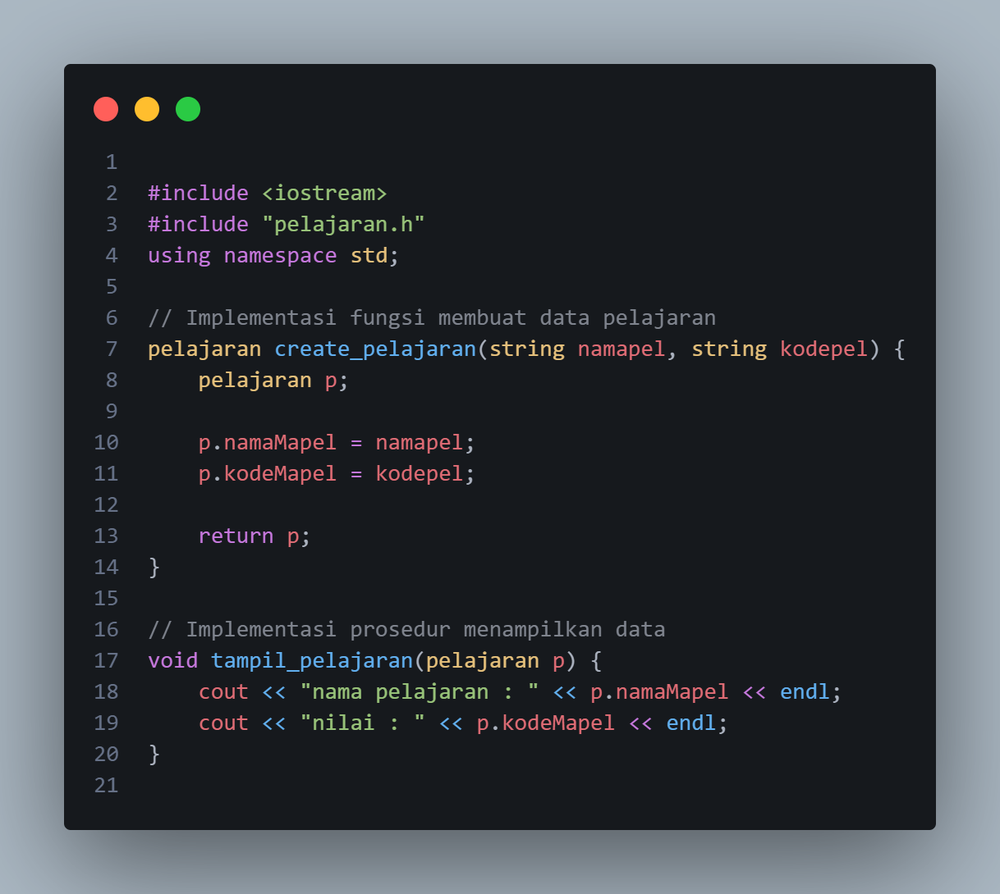

### 2. pelajaran.h
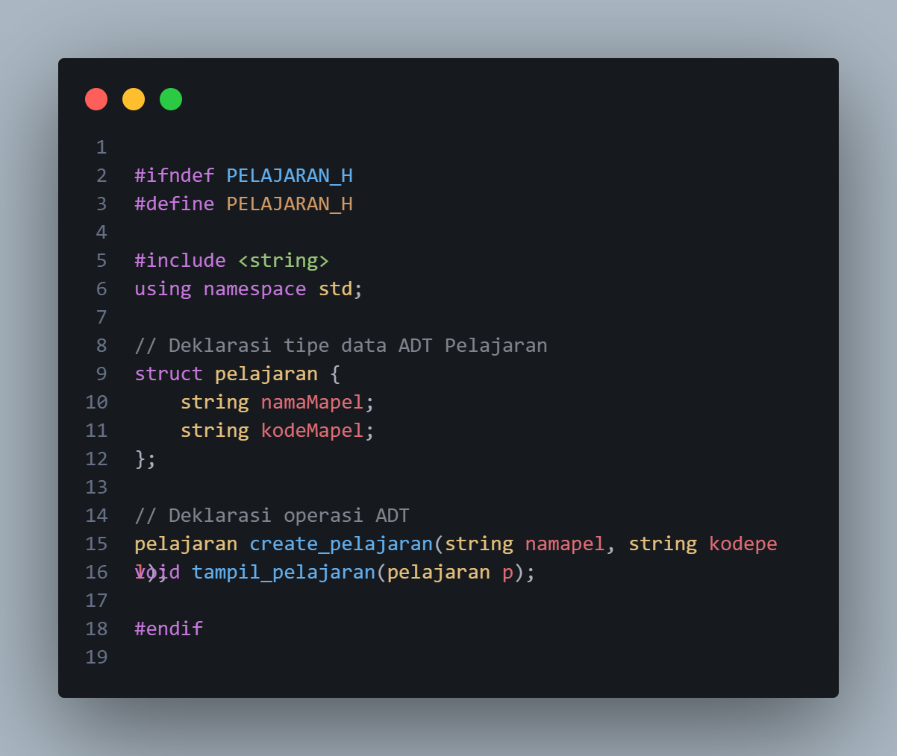

### Output 
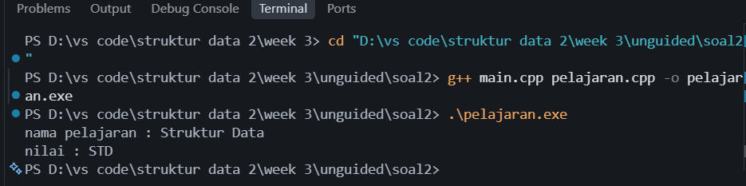

 program dibuat untuk mengimplementasikan konsep Abstract Data Type (ADT) pada data pelajaran menggunakan bahasa C++. Program ini terdiri atas tiga file, yaitu pelajaran.h, pelajaran.cpp, dan main.cpp, yang masing-masing memiliki fungsi berbeda. File pelajaran.h digunakan untuk mendefinisikan struktur data pelajaran yang memiliki anggota namaMapel dan kodeMapel, serta mendeklarasikan fungsi create_pelajaran() dan prosedur tampil_pelajaran(). File pelajaran.cpp berisi implementasi dari fungsi dan prosedur tersebut. Fungsi create_pelajaran() digunakan untuk membuat objek pelajaran dengan mengisi nama mata pelajaran dan kode pelajaran, sedangkan prosedur tampil_pelajaran() digunakan untuk menampilkan data yang telah disimpan. Selanjutnya, file main.cpp berfungsi sebagai program utama yang membuat objek pelajaran dengan nama "Struktur Data" dan kode "STD", kemudian memanggil prosedur untuk menampilkan data tersebut. Hasil eksekusi program menampilkan nama pelajaran dan kode yang telah ditentukan. Melalui praktikum ini, konsep ADT dapat dipahami sebagai cara mengelompokkan data dan operasi dalam struktur yang terorganisasi, sekaligus memisahkan deklarasi, implementasi, dan penggunaan fungsi agar program lebih mudah dipahami dan dikembangkan. 

### 3. soal 3

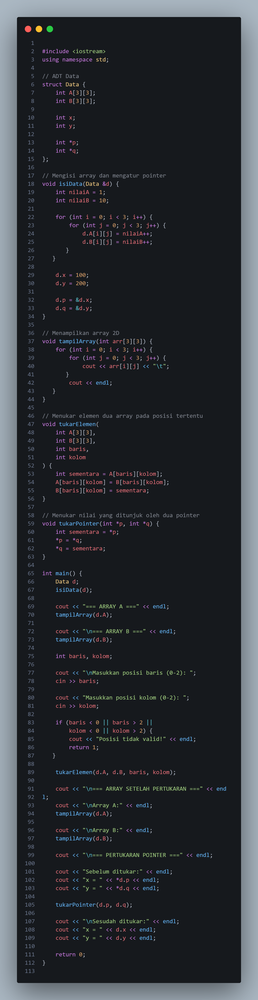
### Output 
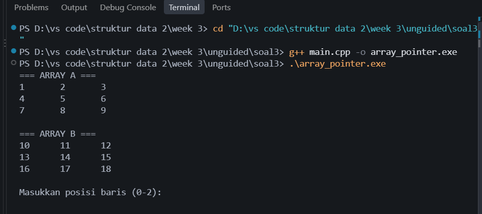

Program ini menerapkan konsep ADT, array dua dimensi, dan pointer dalam bahasa C++. Struktur Data digunakan untuk menyimpan array A dan B berukuran 3×3, variabel x dan y, serta pointer p dan q. Fungsi isiData() mengisi array dengan nilai awal dan mengatur pointer agar menunjuk ke variabel yang sesuai. Fungsi tampilArray() digunakan untuk menampilkan isi array, sedangkan tukarElemen() menukar elemen array A dan B berdasarkan posisi baris dan kolom yang dipilih pengguna. Selanjutnya, fungsi tukarPointer() menukar nilai x dan y melalui pointer. Melalui program ini, dapat dipahami cara mengelola array dua dimensi, menggunakan pointer, dan melakukan pertukaran nilai dengan fungsi secara terstruktur.
## Kesimpulan
Berdasarkan praktikum Struktur Data minggu ke-3, dapat disimpulkan bahwa bahasa C++ menyediakan berbagai konsep untuk mengelola data secara terstruktur, seperti struct, array, ADT, fungsi, prosedur, dan pointer. Melalui ketiga unguided, mahasiswa mempelajari cara menyimpan dan mengolah data mahasiswa, menerapkan ADT dengan memisahkan deklarasi dan implementasi program, serta melakukan pertukaran elemen array dan nilai variabel menggunakan pointer. Dengan praktikum ini, mahasiswa dapat memahami penerapan struktur data dan fungsi dalam membuat program yang lebih terorganisasi, mudah dipahami, dan efisien.

## Referensi
[1] Triase. (2020). Diktat Edisi Revisi : STRUKTUR DATA. Medan: UNIVERSTAS ISLAM NEGERI SUMATERA UTARA MEDAN. 
 [2] Indahyati, Uce., Rahmawati Yunianita. (2020). "BUKU AJAR ALGORITMA DAN PEMROGRAMAN DALAM BAHASA C++". Sidoarjo: Umsida Press. Diakses pada 10 Maret 2024 melalui https://doi.org/10.21070/2020/978-623-6833-67-4.
 ...
